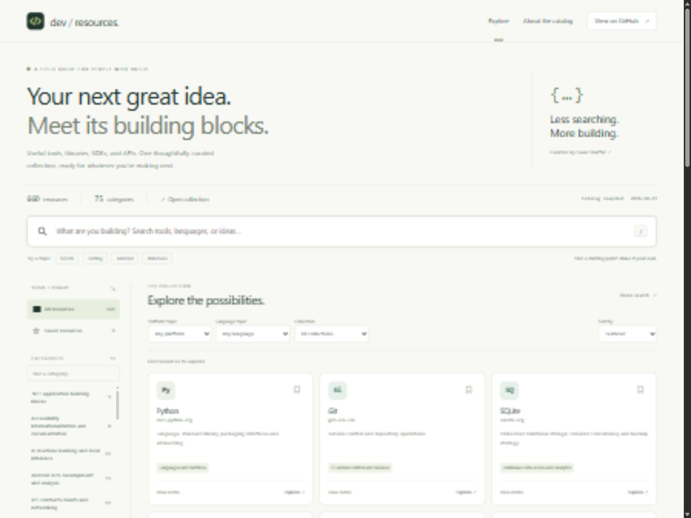

# Dev Resource Explorer

**Find your next building block.** A fast, browser-based explorer for Sean Shaffer’s [development resource catalog](https://github.com/SeanShaffer88/useful-dev-resources).

[Open the explorer](https://SeanShaffer88.github.io/dev-resource-explorer/) · [Source catalog](https://github.com/SeanShaffer88/useful-dev-resources) · [Releases](https://github.com/SeanShaffer88/dev-resource-explorer/releases)



## What it does

- Search names, categories, and descriptions, including quoted phrases.
- Browse 75 categories and filter by collection, platform topic, and language topic.
- Save useful resources in this browser and return to them later.
- Share a link with the current search and filters. Bookmarks are never included.
- Open original links and inspect the full research notes for each catalog entry.
- Switch between featured, alphabetical, and research-date sorting.
- Use a responsive interface with native controls, keyboard focus indicators, a skip link, and modal detail panels. Press `/` to focus search; Escape closes a dialog.

The initial snapshot contains **664 source entries and 660 distinct resource URLs**, imported on **October 22, 2026** from catalog commit [`e068d788cf3a7deb65cec129186ad9db1e665d2f`](https://github.com/SeanShaffer88/useful-dev-resources/commit/e068d788cf3a7deb65cec129186ad9db1e665d2f). Duplicate URLs appear as one card; their original entries and evidence remain intact. The app computes counts from its data rather than hard-coding them.

## Run locally

Install [Node.js](https://nodejs.org/) 22 or later, then:

```sh
git clone https://github.com/SeanShaffer88/dev-resource-explorer.git
cd dev-resource-explorer
npm start
```

Open the printed local URL, normally `http://127.0.0.1:4173`. There are **no packages to install and no build step**. The site itself only requires a modern browser and a static HTTP server. Opening `index.html` with a `file:` URL is unsupported because the browser needs to fetch local JSON and JavaScript modules.

## Validate

```sh
npm test
npm run check
```

Node’s built-in test runner checks search, composed filters, duplicate preservation, sorting, query URLs, bookmark recovery, inferred tags, and unsafe link rejection. The check script verifies the catalog SHA-256, source metadata, license, asset paths, duplicate HTML IDs, and common accidental credential/path patterns. These checks do not audit the linked resources or replace a security review.

## Refresh the catalog

The deployed explorer uses a committed snapshot. Browsing never calls the GitHub API, and updates are deliberately reviewed before publishing.

```sh
# Download the latest public main commit, preserving its exact source bytes.
npm run sync

# Or import a specific reviewed commit.
npm run sync -- --ref FULL_40_CHARACTER_COMMIT_SHA

# Or read committed files from an existing catalog checkout.
npm run sync -- --source ../useful-dev-resources

npm test
npm run check
git diff -- site/data
```

The importer copies `resources.json` and the upstream license, and writes `site/data/meta.json` with the commit, import date, counts, and SHA-256. It refuses non-HTTPS links, embedded credentials, invalid required fields, and an unexpected license family. Empty historical HTTP-status fields remain empty in the data and display as “Not recorded.” `--date YYYY-MM-DD` can explicitly record the actual import date; the default uses America/Chicago.

Commit the reviewed snapshot and push to `main`. The Pages workflow tests it, uploads only `site/`, and deploys it. No scheduled import or third-party service is configured.

## Publish your own copy

1. Fork this repository.
2. Enable GitHub Pages with **GitHub Actions** as the source in repository settings.
3. Push to `main` or manually run **Publish GitHub Pages**.

The relative asset URLs work under a project path. For your own collection, adjust the importer’s source repository, validation provenance, authorship links, and license notices before publishing. Preserve the original catalog attribution when retaining its data.

## Evidence and privacy

Research dates and review scopes belong to the original catalog. A snapshot import is **not** a new maintenance, security, licensing, or compatibility audit. Platform and language labels are heuristic discovery topics inferred from the catalog text; absence or presence of a topic does not establish actual support. “Featured” is a small selection of general starting points, not a quality ranking.

Bookmarks are local to the browser and origin. If storage is blocked, they work only for that visit. There are no analytics, accounts, cookies set by the app, external fonts, or runtime dependencies. GitHub Pages and linked websites apply their own privacy policies. Search terms placed in URLs are visible to anyone you share those URLs with.

## Project structure

```text
site/                  Deployable static website
  app.js               UI rendering, dialogs, local bookmarks, and URL state
  catalog.js           Pure catalog normalization, search, and filtering
  data/                Exact source snapshot, provenance, and catalog license
scripts/               Local server, import, and validation commands
test/                  Node built-in test suite
.github/workflows/     Validation and GitHub Pages publication
docs/                  Screenshot and validation record
```

## License

MIT, copyright 2026 Sean Shaffer. The catalog’s original MIT notice is preserved in [site/data/CATALOG-LICENSE.txt](site/data/CATALOG-LICENSE.txt). Referenced projects and websites retain their own licenses and terms.
